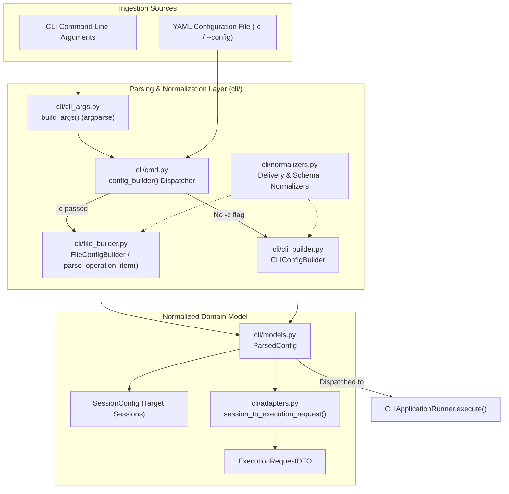

# Command Line User Interface & Ingestion Layer (`cli/`)

## 1. Overview

The [`cli/`](__init__.py) package provides the command-line based interface ingestion and configuration compilation engine for **`netmgnt-client-py`**. It parses both:
1. **Interactive CLI Subparsers:** Nested `argparse` commands for ad-hoc inspection (`client_main.py gnmi ...`, `client_main.py netconf ...`).
2. **Hierarchical YAML Configurations:** Multi-target, multi-operation, and streaming telemetry orchestration pipelines (`client_main.py -c config.yaml`).

Regardless of the ingestion source (CLI or YAML), the parser compiles and normalizes inputs into a single canonical [`ParsedConfig`](cmd.py) instance consumed directly by [`ManagerFactory`](../managers/manager.py).

---

## 2. Module Inventory

| File | Primary Exports | Responsibility |
| :--- | :--- | :--- |
| [`cli/cmd.py`](cmd.py) | `build_args`, `config_builder`, `parse_args`, `ParsedConfig`, `CLIConfigBuilder`, `FileConfigBuilder`, `parse_operation_item` | Unified backwards-compatible presentation facade re-exporting all cli submodules and dispatchers. |
| [`cli/models.py`](models.py) | `ParsedConfig`, `ConfigBuilder`, `FileConfigError` | Normalized domain execution configuration and base builder interfaces. |
| [`cli/normalizers.py`](normalizers.py) | `resolve_delivery_mode`, `extract_filter_expression`, `_parse_schema_config` | Telemetry delivery mode translation (RFC 8641), XPath/subtree filter extraction, and YANG schema compilation. |
| [`cli/cli_args.py`](cli_args.py) | `build_args`, `netconf_args`, `gnmi_args`, `add_schema_args`, `PairedAction` | CLI `argparse` hierarchy, interleaved paired option tracking, and subparser definitions. |
| [`cli/cli_builder.py`](cli_builder.py) | `CLIConfigBuilder` | Translates interactive CLI arguments into `ParsedConfig` sessions and operations. |
| [`cli/file_builder.py`](file_builder.py) | `FileConfigBuilder`, `parse_operation_item` | Ingests hierarchical YAML pipelines, operation sequences, targets, and device inventories. |
| [`cli/adapters.py`](adapters.py) | `session_to_execution_request`, `execution_request_to_session` | Bidirectional adapters between internal `SessionConfig` and Application Service Layer `ExecutionRequestDTO`. |
| [`cli/runner.py`](runner.py) | `CLIApplicationRunner`, `CLIStreamRunner` | Presentation execution runners coordinating unary batches and streaming telemetry with `OutputHandler`. |
| [`cli/__init__.py`](__init__.py) | Package exports | Exposes primary public interface helpers. |

---

## 3. Architecture & Ingestion Flow



---

## 4. Key Component Reference

### 4.1 `ParsedConfig` ([`cli/cmd.py`](cmd.py))
The canonical top-level execution model:
* **`sessions: List[SessionConfig]`**: The list of all target sessions to instantiate and execute.
* **`outputs: List[OutputConfig]`**: Output destination configurations (`stdout`, `stderr`, `file`, `syslog`) with formatting instructions (`json`, `xml`, `text`).
* **`debug: bool`**: Global debug logging flag.
* **`syslog_server` / `log_file` / `log_level`**: Application logging parameters.

### 4.2 CLI Argument Parser (`build_args`) ([`cli/cmd.py`](cmd.py))
Constructs the nested subparser hierarchy:
* **Top-Level Flags:** Connection targets (`-t`), credentials (`-u`, `-p`, `-i`), security certificates (`--tls-ca`, `--ssh-key`), outputs (`--output-type`, `--output-format`), and YAML config loading (`-c`).
* **Protocol Subparsers:**
  * `client_main.py gnmi ...` (`capability`, `get`, `set`, `subscribe`)
  * `client_main.py netconf ...` (`capability`, `get`, `get-config`, `get-schema`, `edit-config`, `commit`, `discard-changes`, `subscribe`)
* **Paired Option Parsing (`PairedAction`):** Enforces strict pairing between `--update-path` and `--update-value` (or `--update-file`), supporting both interleaved arguments and batch syntax.

### 4.3 YAML Pipeline Parser (`FileConfigBuilder`) ([`cli/cmd.py`](cmd.py))
Translates complex YAML structures into sessions:
* **Target Mapping:** Parses `targets:` dictionaries where keys are `IP:PORT` and values define credentials, operations, or subscriptions.
* **Sequential Operation Pipelines:** Parses `operations:` lists, converting step definitions (`capability: {}`, `get: {path: ...}`, `edit-config: {config: ...}`) into ordered [`OperationConfig`](../config/operations.py) sequences.
* **Multi-Target Telemetry Subscriptions:** Parses `subscriptions:` definitions, resolving sample intervals, encoding, and mapping them to targets.
* **Schema Bindings:** Parses `schema:` blocks, loading local YANG directories (`yang_dirs`), cache locations, and validation flags.

### 4.4 Delivery Mode Resolution (`resolve_delivery_mode`) ([`cli/cmd.py`](cmd.py))
Translates interface vocabulary (`--mode once|poll|stream`, `--sub-mode sample|on_change`) into protocol-neutral [`DeliveryMode`](../config/delivery.py) members:
* `stream + sample` -> `DeliveryMode.PERIODIC`
* `stream + on_change` -> `DeliveryMode.EVENT_DRIVEN`
* `once` -> `DeliveryMode.SNAPSHOT`
* `poll` -> `DeliveryMode.ON_DEMAND`

---

## 5. Usage Examples

### 5.1 Parsing CLI Arguments Programmatically
```python
from cli.cmd import build_args, config_builder

# Simulate CLI invocation
raw_args = [
    "-t", "172.20.20.2:57401",
    "-u", "admin",
    "-p", "NokiaSrl1!",
    "-i",
    "gnmi", "get",
    "--path", "/interfaces/interface[name=mgmt0]/state",
]

args = build_args(raw_args)
cfg = config_builder(args)

print(f"Loaded {len(cfg.sessions)} session(s)")
print("Protocol:", cfg.sessions[0].protocol)
print("Target:", cfg.sessions[0].target)
```

### 5.2 Building Configuration from YAML
```python
from cli.cmd import FileConfigBuilder

yaml_path = "tests/fixtures/netconf_transaction_pipeline_test.yaml"
builder = FileConfigBuilder(config_path=yaml_path, protocol="netconf")
parsed_cfg = builder.build()

session = parsed_cfg.sessions[0]
print(f"Target: {session.target}")
print(f"Total Operations in Pipeline: {len(session.operations)}")
for idx, op in enumerate(session.operations):
    print(f"  Step {idx+1}: {op.__class__.__name__}")
```

