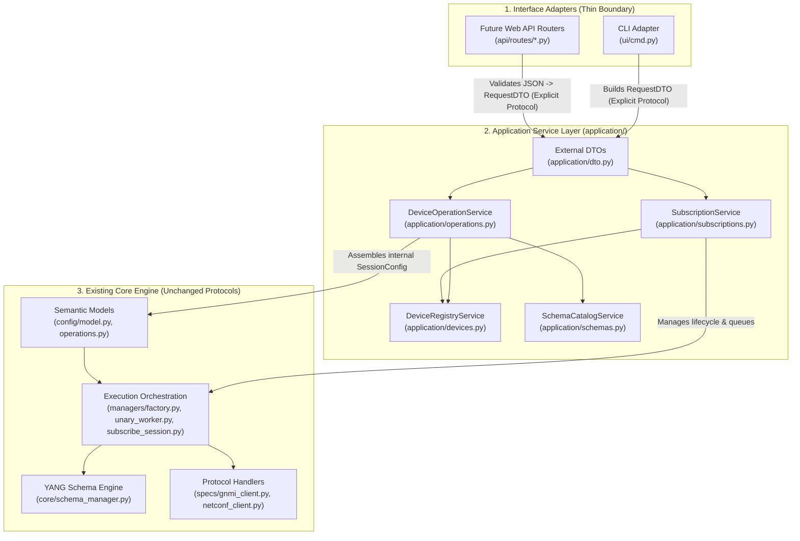
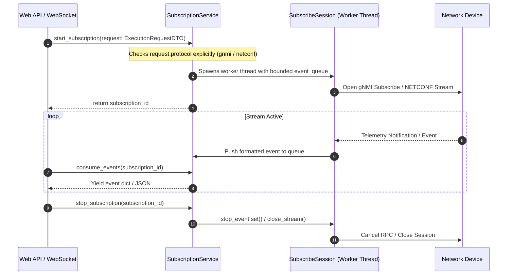

# Architectural Specification & Implementation Guide: Application Service Layer

**Target Repository:** `netmgmt-client-py`

**Objective:** Decouple external caller intent (CLI / Web API / Scripts) from internal engine execution context (`ParsedConfig`, `SessionConfig`, `OutputHandler`) by introducing a dedicated Application Service Layer (`application/`) with **explicit protocol declaration**.

---

## 1. Problem Statement & Architectural Motivation

Currently, `ui/cmd.py` and `client_main.py` parse CLI arguments or YAML files directly into `ParsedConfig` and `SessionConfig` (in `config/model.py`), which are then passed down through `ManagerFactory`, `UnaryWorker`, and `SubscribeSession`.

> [!NOTE] `UnaryWorker` is an alias of `SequentialWorker`.

While effective for a single-run CLI script, `ParsedConfig` currently acts as an all-encompassing container carrying:

1. **Operational Intent:** Operations (`GetOperation`, `SetOperation`, `SubscribeOperation`), paths/selectors, and payloads.
2. **Device Transport & Secrets:** Target IP/port, protocol, username, password, SSH keys, and TLS certificate paths.
3. **CLI Presentation & Sinks:** `outputs` dictionary (`stdout`, local file paths) and global logging levels.
4. **Schema Engine Lifecycle:** `SchemaProfile` and local filesystem YANG directories.

### Why This Blocks Web GUI & API Adoption

* **Excessive External Exposure:** A web frontend or REST/WebSocket client should only submit *operational intent* (e.g., `protocol: "gnmi"`, `device_id: "spine-01"`, `operation: "get"`, `paths: [...]`). It must never construct raw `SecurityProfile` objects, filesystem paths, or `OutputHandler` configurations.
* **Sink Coupling (`OutputHandler`):** Workers currently push formatted responses into `OutputHandler` queues (which write to terminal `stdout` or disk files) rather than returning structured result objects directly to the caller.
* **Stateful Lifecycle Mismatch:** Web subscriptions (`SubscribeSession`) and interactive transactions outlive single HTTP requests and require a middle-layer registry to track active sessions by ID.

---

## 2. Target Architecture & Responsibility Matrix

The **Application Service Layer (`application/`)** sits between **Interface Adapters** (`ui/cmd.py`, future `api/routes/`) and the **Core Engine** (`config/`, `managers/`, `core/`, `specs/`).



### Explicit Protocol Design Principle

> **"Explicit is better than implicit."**
> 
> Modern network switches (such as Nokia SR Linux, Arista EOS, or Cisco IOS-XR) frequently run **both** gNMI and NETCONF on the same device simultaneously, often on non-standard ports or behind reverse proxies.
> 
> Therefore, the Application Service Layer **never guesses or infers the protocol** via port heuristics or operation semantics. The calling layer (CLI subcommand, Web API payload, or stored device profile) **must explicitly declare** `protocol: "gnmi" | "netconf"`. If an unknown or missing protocol is received, the service raises an immediate validation error.

### Information Partitioning Matrix

| Information Domain | External Request (`application/dto.py`) | Application Service Layer (`application/`) | Internal Engine (`config/`, `managers/`) |
| :--- | :--- | :--- | :--- |
| **Protocol Declaration** | **Explicit** `protocol: "gnmi" \| "netconf"` in request DTO or device profile. | Validates against supported protocols; rejects unknown protocols immediately. | `DeliveryConfig.protocol` / `SessionConfig.protocol` |
| **Target Identity** | `device_id: str` (Web) **OR** `adhoc_endpoint: AdhocEndpointDTO` (CLI/Ad-hoc) | Resolves `device_id` via `DeviceRegistryService` into host, port, protocol, and credentials. | `SessionConfig(target, protocol, ...)` |
| **Credentials & TLS** | Omitted in Web requests (or referenced by secret ID); explicit in ad-hoc calls. | Injects credentials, SSH keys, and TLS certs from secure store into `SecurityProfile`. | `SecurityProfile` & `TLSProfile` (`modules/security.py`) |
| **Operational Intent** | `operations: list[OperationStepDTO]` (action, paths, payload, options). | Translates DTOs into `GetOperation`, `SetOperation`, `NetconfTransactionOperation`, etc. | `SessionConfig.operations: list[OperationConfig]` |
| **YANG Schema Config** | `schema_profile_id: Optional[str]`, `validate_only: bool` | Resolves `SchemaProfile` from catalog and runs pre-flight validation via `SchemaManager`. | `SchemaProfile` & `core/schema_manager.py` |
| **Output & Results** | None (Caller awaits return value or stream iterator). | Collects worker return payloads and wraps them into `ExecutionResultDTO`. | `UnaryWorker` returns structured `list[dict]`; `OutputHandler` is an optional sink. |

---

## 3. Target Directory Structure

Create the `application/` package at the repository root without breaking existing packages:

```
netmgmt-client-py/
├── application/                  # [NEW] Application Service Layer
│   ├── __init__.py
│   ├── dto.py                    # External Request / Result Data Transfer Objects
│   ├── devices.py                # Device inventory & credential resolution service
│   ├── operations.py             # Unary & pipeline operation execution service
│   ├── subscriptions.py          # Stateful subscription registry & event stream broker
│   └── schemas.py                # YANG schema browsing & pre-flight validation service
├── config/                       # [EXISTING] Internal semantic domain models
├── core/                         # [EXISTING] YANG schema engine
├── managers/                     # [MODIFIED] Return results directly; optional OutputHandler
├── modules/                      # [EXISTING] Formatter, OutputHandler, Security, Logger
├── specs/                        # [EXISTING] gNMI & NETCONF clients and validators
├── ui/                           # [MODIFIED] Extracts config assembly to application/
└── client_main.py                # [MODIFIED] Invokes application services
```

---

## 4. Step-by-Step Implementation Instructions

### Step 1: Define External DTO Contracts (`application/dto.py`)

Create pure dataclasses in `application/dto.py` representing external requests and standardized responses. These classes must **never** import `grpc`, `ncclient`, `argparse`, or `OutputHandler`.

#### Required Classes in `application/dto.py`:

1. **`AdhocEndpointDTO`**: Used by the CLI (or quick connectivity tests) when a target device is specified inline via host/port/credentials rather than looked up by `device_id`.
2. **`OperationStepDTO`**: Represents a single semantic operation in a request pipeline:
   * `op_type`: `"capabilities" | "get" | "set" | "subscribe" | "lock" | "unlock" | "commit" | "cancel_commit" | "discard_changes"`
   * `paths`: `list[str]`
   * `prefix`: `Optional[str]`
   * `origin`: `Optional[str]`
   * `datastore`: `Optional[str]` (e.g., `"running"`, `"candidate"`, `"all"`)
   * `updates`: `list[dict[str, Any]]` (path + value pairs for Set/Edit)
   * `replaces`: `list[dict[str, Any]]`
   * `deletes`: `list[str]`
   * `xml_payload`: `Optional[str]` (for raw NETCONF `<edit-config>`)
   * `options`: `dict[str, Any]` (protocol-specific dials like `encoding`, `confirmed`, `confirm_timeout`, `default_operation`)
3. **`ExecutionRequestDTO`**:
   * `device_id`: `Optional[str] = None`
   * `adhoc_endpoint`: `Optional[AdhocEndpointDTO] = None`
   * `operations`: `list[OperationStepDTO]`
   * `protocol`: `str`
   * `schema_profile_id`: `Optional[str] = None`
   * `validate_only`: `bool = False`
   * `timeout_seconds`: `int = 30`
4. **`StepResultDTO` & `ExecutionResultDTO`**:
   * `success`: `bool`
   * `target`: `str`
   * `protocol`: `"netconf" | "gnmi"`
   * `step_results`: `list[StepResultDTO]` (each containing `op_type`, `status`, `formatted_data`, `error_message`)
   * `execution_time_ms`: `float`

```python
# application/dto.py
from dataclasses import dataclass, field
from enum import Enum
from typing import Any, Optional


class SupportedProtocol(str, Enum):
    GNMI = "gnmi"
    NETCONF = "netconf"

class DeliveryModeDTO(str, Enum):
    PERIODIC = "periodic"
    EVENT_DRIVEN = "event_driven"
    SNAPSHOT = "snapshot"
    ON_DEMAND = "on_demand"


@dataclass(kw_only=True)
class TelemetryPolicyDTO:
    mode: DeliveryModeDTO = DeliveryModeDTO.PERIODIC
    sample_interval_sec: float = 10.0
    heartbeat_interval_sec: Optional[float] = None
    suppress_redundant: bool = False


@dataclass(kw_only=True)
class MutationChangeDTO:
    path: str
    value: Optional[Any] = None
    operation: str = "merge"  # "merge" | "replace" | "delete" | "remove"

@dataclass(kw_only=True)
class AdhocEndpointDTO:
    """Used when target connection parameters are specified inline (CLI or ad-hoc API)."""
    target: str  # "<host>:<port>"
    protocol: str  # Mandatory: "gnmi" | "netconf"
    username: Optional[str] = None
    password: Optional[str] = None
    tls_ca: Optional[str] = None
    tls_cert: Optional[str] = None
    tls_key: Optional[str] = None
    skip_verify: bool = False
    gnmi_use_tunnel: bool = False
    gnmi_target_name: Optional[str] = None


@dataclass(kw_only=True)
class OperationStepDTO:
    op_type: str  # "capabilities" | "get" | "set" | "subscribe" | "lock" | "unlock" | "commit" | "discard_changes"
    # Selectors
    paths: list[str] = field(default_factory=list)
    filter_expression: Optional[str] = None
    filter_type: Optional[str] = None  # "xpath" | "subtree"
    prefix: Optional[str] = None
    datastore: str = "all"  # "running" | "candidate" | "startup" | "all"
    
    # Mutations (Set / Edit-Config)
    changes: list[MutationChangeDTO] = field(default_factory=list)
    xml_payload: Optional[str] = None
    
    # Telemetry
    telemetry: Optional[TelemetryPolicyDTO] = None
    
    # Protocol-specific options (encoding, lock, confirmed, confirm_timeout)
    options: dict[str, Any] = field(default_factory=dict)


@dataclass(kw_only=True)
class ExecutionRequestDTO:
    """Top-level external execution request."""
    # Target resolution: either pre-registered device_id OR adhoc_endpoint
    device_id: Optional[str] = None
    adhoc_endpoint: Optional[AdhocEndpointDTO] = None

    # Protocol override (optional if device_id profile has it defined)
    protocol: Optional[str] = None

    operations: list[OperationStepDTO] = field(default_factory=list)
    schema_profile: Optional[dict[str, Any]] = None
    validate_only: bool = False
    timeout_seconds: int = 30


@dataclass(kw_only=True)
class StepResultDTO:
    op_type: str
    success: bool
    data: Optional[Any] = None
    error: Optional[str] = None


@dataclass(kw_only=True)
class ExecutionResultDTO:
    target: str
    protocol: str
    success: bool
    results: list[StepResultDTO] = field(default_factory=list)
    error_summary: Optional[str] = None
    execution_time_ms: float = 0.0
```

---

### Step 2 : Direct Result Collection in `DeviceOperationService`

`BaseUnaryWorker` subclasses already execute via `.start()` and return pure structured dictionaries without referencing `OutputHandler`.
So `DeviceOperationService.execute_unary()` can instantiate the appropriate worker and call `worker.start()` directly:

- Invoke `worker.start()` to obtain the raw result dict.
- Transform the returned dictionary into an `ExecutionResultDTO`.
- _Optional CLI Sink_: If an `output_handler` is explicitly passed (e.g., from the CLI adapter), invoke `output_handler.write(result)` before returning the DTO.

---

### Step 3: Implement `DeviceRegistryService` (`application/devices.py`)

This service manages device connection profiles and resolves endpoints with explicit protocols.

#### Responsibilities:
1. Maintain an in-memory (or configuration-backed) registry of known devices (`device_id -> AdhocEndpointDTO`).
2. Expose `resolve_endpoint(request: ExecutionRequestDTO) -> AdhocEndpointDTO`:
   * `request.protocol` should be set by upper layer.
   * If `request.device_id` is set, look up the registered device profile and return its endpoint/security details.
   * If `request.adhoc_endpoint` is set (such as from CLI flags or YAML target blocks), validate and return it directly.
   * Raise a clear `DeviceNotFoundError` if neither is valid.

---

### Step 4: Implement `DeviceOperationService` (`application/operations.py`)

Move the domain model assembly logic (currently buried inside `ui/cmd.py` helper functions like `_build_session_config`) into `DeviceOperationService`.
Handles explicit protocol validation too.

#### Responsibilities:
1. **`build_session_config(request: ExecutionRequestDTO) -> SessionConfig`**:
   * Resolves the endpoint via `DeviceRegistryService`.
   * Constructs `SecurityProfile` from the resolved endpoint credentials.
   * Maps each `OperationStepDTO` into the internal semantic operation classes (`CapabilitiesOperation`, `GetOperation`, `SetOperation`, `NetconfTransactionOperation`) and `ProtocolOptions` (`GnmiOptions`, `NetconfOptions`).
   * Attaches `SchemaProfile` if present.
2. **`execute_unary(request: ExecutionRequestDTO, output_handler: Optional[OutputHandler] = None) -> ExecutionResultDTO`**:
   * Builds the internal `SessionConfig`.
   * If `request.validate_only` is `True`, initializes `SchemaManager` and runs `ValidatorFactory` / `SchemaValidator` without opening a network socket, returning the validation outcome in `ExecutionResultDTO`.
   * Otherwise, runs `worker.start()` on the resolved worker (`SequentialWorker` or unary worker).
   * Wraps the returned step results into an `ExecutionResultDTO`.

---

### Step 5: Implement `SubscriptionService` (`application/subscriptions.py`)

Manages streaming telemetry lifecycles with thread-safe queues.



#### Responsibilities:
1. Maintain an active registry: `_active_subscriptions: dict[str, ManagedSubscription]`.
2. **`start_subscription(request: ExecutionRequestDTO) -> str`**:
   * Validates explicit protocol (`"gnmi"` or `"netconf"`).
   * Generates a unique `subscription_id` (UUID).
   * Creates a thread-safe bounded queue (`queue.Queue(maxsize=1000)`) or callback sink.
   * Starts `SubscribeSession` in a daemon thread and stores the handle in `_active_subscriptions[subscription_id]`.
3. **`send_command(subscription_id: str, command: StreamCommand)`**:
   * Pushes `POLL` or `STOP` commands into the session's `StreamContext` command queue (reusing `specs/stream_types.py`).
4. **`stop_subscription(subscription_id: str) -> bool`**:
   * Signals termination via `StreamContext.stop()`, joins the worker thread with a timeout, and cleans up resources.

---

### Step 6: Refactor Presentation Adapters to Use the Layer

#### A. How `ui/cmd.py` Interacts with `application/`
1. **Keep in `ui/cmd.py`**:
   * `argparse` parser definitions (`build_parser()`).
   * Raw YAML file loading (`yaml.safe_load()`).
   * Constructing `OutputHandler` from the `outputs:` section of the YAML or CLI flags (`--output-format`, `--output-file`).
2. **Delegate to `application/`**:
   * Convert parsed CLI args or YAML `targets:` entries into `list[ExecutionRequestDTO]`.
   * Call `DeviceOperationService.execute_unary(dto, output_handler=cli_output_handler)` for unary commands, or `SubscriptionService` for streaming commands.
   * Remove duplicate `SessionConfig` / `OperationConfig` construction boilerplate from `ui/cmd.py`.


#### B. How Future Backend Web Routers (`api/routes/operations.py`) Interact with `application/`

```python
# In api/routes/operations.py
from fastapi import APIRouter, Depends, HTTPException
from application.dto import ExecutionRequestDTO, ExecutionResultDTO
from application.operations import DeviceOperationService

router = APIRouter(prefix="/api/v1/operations", tags=["operations"])

@router.post("/execute", response_model=ExecutionResultDTO)
def execute_device_operation(
    request: ExecutionRequestDTO,
    service: DeviceOperationService = Depends(get_operation_service),
) -> ExecutionResultDTO:
    """Executes unary operations with explicit protocol; returns structured JSON directly."""
    # protocol is explicitly supplied in request.protocol or resolved via device_id
    result = service.execute_unary(request, output_handler=None)
    if not result.success and result.error_summary:
        raise HTTPException(status_code=400, detail=result.error_summary)
    return result
```

---

## 5. Verification & Acceptance Checklist

Before considering the Application Service Layer complete, verify the following criteria:

* [ ] **Explicit Protocol Enforcement**: Verify that submitting a request with an invalid or missing protocol raises `UnsupportedProtocolError` immediately without guessing.
* [ ] **Zero Presentation Leakage in `application/`**: Confirm `application/` contains no imports of `argparse`, `sys.stdout`, `fastapi`, or `ui.cmd`.
* [ ] **Direct Return Values from Workers**: Verify `worker.start()` returns structured Python data even when `output_handler=None`.
* [ ] **100% CLI & YAML Backward Compatibility**: Run existing test suites (`pytest tests/unit tests/composite`) to confirm CLI commands and YAML fixtures (`tests/fixtures/*.yaml`) pass without regressions.
* [ ] **Unit Tests for `application/`**: Add `tests/unit/test_application_services.py` testing:
  * Execution with explicit `protocol="gnmi"` and `protocol="netconf"`.
  * Rejection of invalid protocols (`protocol="snmp"` -> `UnsupportedProtocolError`).
  * Device profile lookup and credential injection via `DeviceRegistryService`.
  * Starting, consuming, and stopping a stream via `SubscriptionService`.